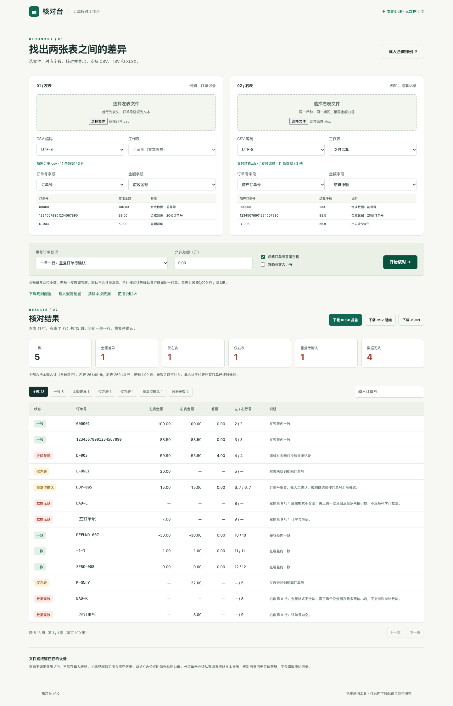
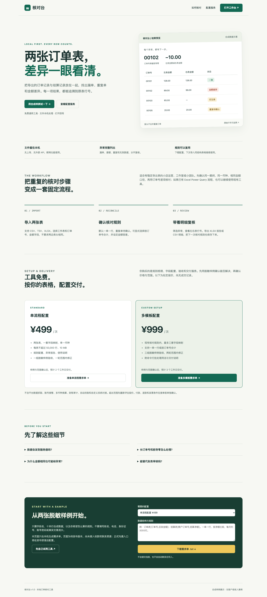

# 核对台

免费、开源的本地 Excel / CSV 订单核对工具，用于检查漏单、重复订单和金额差异。

**[在线试用](https://heduitai-orders.copperdace20.chatgpt.site)** · 离线下载见本仓库的 **Releases** · 使用问题和主动询价可在本仓库 **Issues** 留言。



## 能做什么

- 导入 CSV、TSV、XLSX，选择订单号和金额字段。
- 检查单侧缺失、重复订单与金额差异；重复单默认需要确认。
- 导出 Excel 报告、CSV 明细和 JSON；可保存和复用核对规则。
- 浏览器本机处理文件；离线包无需安装、账号、联网或付费 API。
- 附完全合成的样例数据，以及可选的 Node.js 命令行批处理。

## 开始使用

1. 在 Releases 下载 `heduitai-v1.0.zip`，解压整个文件夹。
2. 双击 `index.html`，打开工作台，点击“载入合成样例”。
3. 查看示例核对结果，再导入自己的两张表。详细步骤见包内 `docs/使用说明.md`。

每表支持 50,000 条数据、100 列、10 MB；单币种、两位小数金额。请将订单号以文本形式从来源系统导出，已丢失的精度无法恢复。结果用于定位差异，实际业务处理需人工确认。

## 源码与许可

离线 ZIP 内含完整 HTML / CSS / JavaScript 源码、命令行工具、测试、使用说明和依赖。自有代码使用 [MIT 许可](LICENSE)。内置 SheetJS CE 0.20.3 使用 Apache-2.0，原许可与依赖校验信息随离线包提供。

解压后可在目录内运行测试（需要已有 Node.js 18+）：

```sh
node --test tests/*.test.cjs
```

## 可选配置服务

通用工具免费。可选字段映射、规则配置和验收交付服务，候选报价为 **¥499 / ¥999**，按实际需求确认范围。当前尚无客户成交或收入记录。询价请仅描述表结构、字段名和需求，勿在公开 Issues 上传真实订单、手机号、账号或支付资料。


